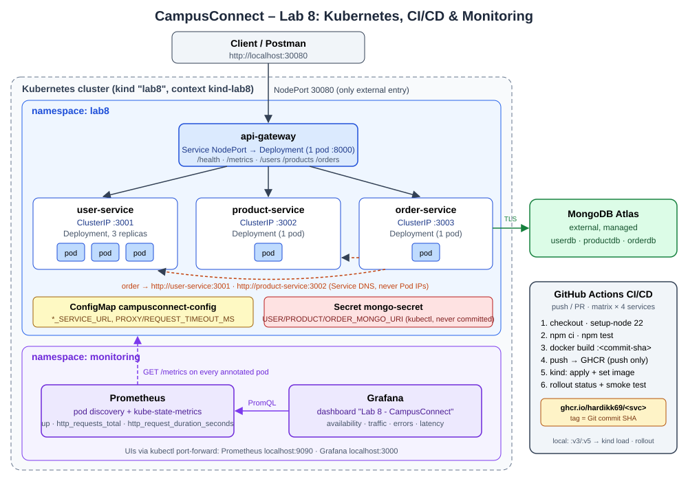
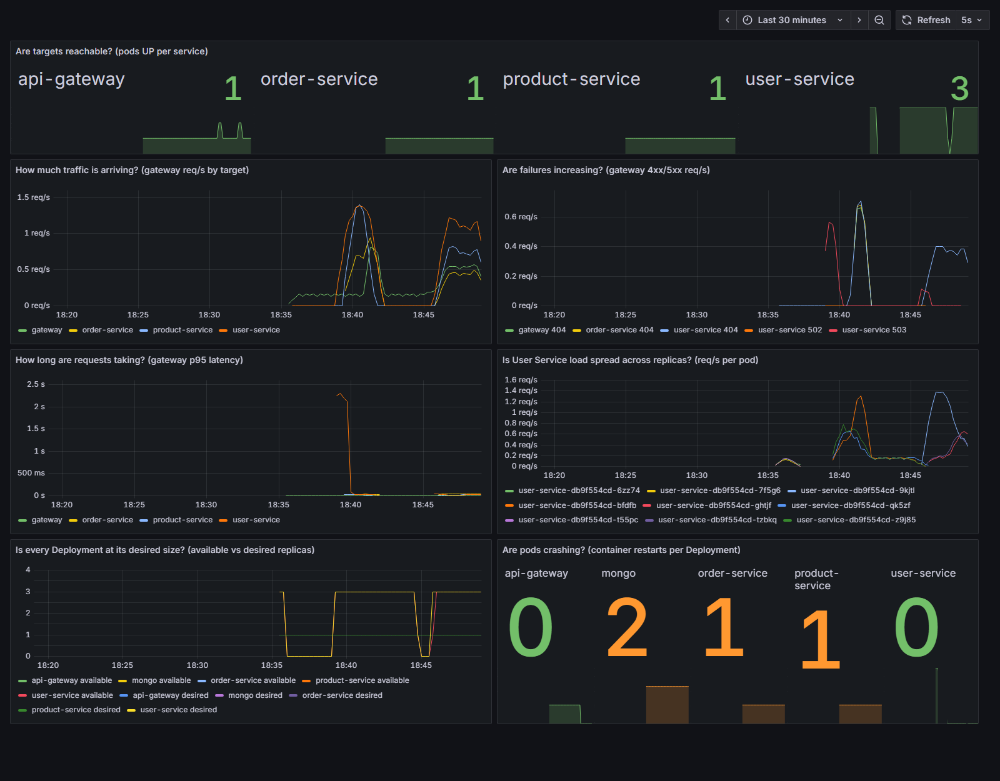

# Lab 8: Kubernetes, CI/CD & Monitoring – CampusConnect

## Overview
Lab 7's application (API Gateway + User / Product / Order services, MongoDB Atlas) is copied here and moved onto a DevOps workflow:

1. **Kubernetes** – all four services run as Deployments + Services in namespace `lab8`, with configuration in a ConfigMap and Atlas URIs in a Secret. Liveness/readiness probes, scaling, self-healing and rolling updates are demonstrated.
2. **GitHub Actions CI/CD** – `git push → build/test → Docker image → GHCR → Kubernetes deployment → verification`. Images are tagged with the Git commit SHA.
3. **Prometheus + Grafana** – every service exposes `/metrics`; kube-state-metrics adds Kubernetes workload health. Grafana shows availability, traffic, errors, latency, replicas and restarts.

### Changes to the Lab 7 code
| Change | Why |
|---|---|
| `cors()` on the gateway | **Lab 7 revision** – browser (React) clients can call the gateway; preflights are answered at the edge |
| Failure test uses **User Service** (`GET /users/101`: 200 → stop → 503 → restart → 200) | **Lab 7 revision** – Postman folder 4 |
| `prom-client` middleware + `GET /metrics` in each `server.js` | Prometheus needs `http_requests_total`, `http_request_duration_seconds` and Node defaults |
| `GET /ready` (503 until MongoDB is connected) + retried first DB connection | Readiness must mean "can serve traffic". Mongoose never retries a failed *first* connect, so a Pod started before DNS/DB was up stayed broken while reporting Ready |
| Gateway: upstream agent with a connect timeout, keep-alive off | `proxyTimeout` only starts after TCP connect, so a just-deleted Pod IP hung the first request for ~130 s. With keep-alive on, one reused connection pinned all traffic to a single replica, which made scaling useless |
| `test/server.test.js` + `"test": "node --test"` per service, lockfiles | CI runs `npm ci` + `npm test` |
| Log prints the DB name, not the URI; `.env` ignored | never leak Atlas credentials (logs or git) |

Routes, request/response bodies and status codes are unchanged. The Lab 7 `compose.yaml` and `render.yaml` still work.

## Architecture


```
git push ─► GitHub Actions: npm ci/test ─► docker build ─► ghcr.io/hardikk69/<svc>:<sha> ─► kind cluster ─► rollout + smoke test

Client / Postman ─► localhost:30080 (NodePort) ─► api-gateway Service ─► api-gateway Pod
                                                   │  http://user-service:3001 · product-service:3002 · order-service:3003
                                                   ▼
                              user-service (×3) · product-service · order-service ─► MongoDB Atlas
Prometheus (ns monitoring) ── /metrics of every lab8 pod + kube-state-metrics ─► Grafana dashboard
```

## Project Structure
```
Lab-8/
├── api-gateway/ user-service/ product-service/ order-service/   (+ /metrics, /ready, test/)
├── k8s/
│   ├── configmap.yaml
│   ├── gateway-deployment.yaml   gateway-service.yaml     (NodePort 30080)
│   ├── user-deployment.yaml      user-service.yaml        (ClusterIP 3001, 3 replicas)
│   ├── product-deployment.yaml   product-service.yaml     (ClusterIP 3002)
│   ├── order-deployment.yaml     order-service.yaml       (ClusterIP 3003)
│   └── monitoring/
│       ├── 00-namespace.yaml     namespace "monitoring" (applied first)
│       ├── prometheus.yaml       RBAC, scrape config, Deployment, Service
│       ├── kube-state-metrics.yaml
│       └── grafana.yaml          data source + dashboard provisioning, Deployment, Service
├── docs/grafana-dashboard.png    dashboard after traffic + failure experiments
├── kind-config.yaml              local cluster (maps NodePort 30080 → localhost)
├── compose.yaml / render.yaml    Lab 7
└── API-Gateway-Lab7.postman_collection.json
CI/CD workflow: ../.github/workflows/ci.yml (repository root)
```

## Prerequisites & Kubernetes environment
| Tool | Version used |
|---|---|
| Docker Desktop | 29.6.1 |
| kind (Kubernetes in Docker) | v0.30.0 → Kubernetes v1.34.0, 1 control-plane node |
| kubectl | v1.36.1 |
| Node.js | 22 |

**Selected environment: kind**, a single-node local cluster inside Docker. `kind-config.yaml` maps the gateway's NodePort `30080` to `localhost:30080`.

## 1. Cluster & context
```bash
kind create cluster --config kind-config.yaml     # cluster "lab8", context "kind-lab8"
kubectl config current-context
kubectl get nodes
kubectl create namespace lab8
```
```
kind-lab8
NAME                 STATUS   ROLES           AGE   VERSION
lab8-control-plane   Ready    control-plane   13d   v1.34.0
```

## 2. Images, registry & tagging
| Where | Image name | Tag |
|---|---|---|
| CI/CD (registry) | `ghcr.io/hardikk69/<service>` | full Git commit SHA, e.g. `75a72ba5e52535ebd84a59db72f729420848a9f4` – traceable to the exact commit |
| Local kind cluster | `<service>` | semantic versions `v2`, `v3`, `v4`, `v5` (bumped in the manifest on each change) |

Images are never tagged `latest`. Locally, kind nodes can't see the host's images, so they are loaded into the node:
```bash
for s in api-gateway user-service product-service order-service; do
  docker build -t $s:v3 ./$s
done
# Docker Desktop with the containerd image store: save single-platform first
docker save --platform linux/amd64 -o images.tar api-gateway:v5 user-service:v3 product-service:v3 order-service:v3
kind load image-archive images.tar --name lab8
```
To run the registry image instead: `kubectl set image deployment/user-service user-service=ghcr.io/hardikk69/user-service:<sha> -n lab8` (the GHCR packages are public, so no pull secret is needed).

## 3. Configuration
| Object | Name | Keys | Used by |
|---|---|---|---|
| ConfigMap | `campusconnect-config` | `USER_SERVICE_URL`, `PRODUCT_SERVICE_URL`, `ORDER_SERVICE_URL`, `PROXY_TIMEOUT_MS`, `REQUEST_TIMEOUT_MS` | gateway, order-service (`envFrom`) |
| Secret | `mongo-secret` | `USER_MONGO_URI`, `PRODUCT_MONGO_URI`, `ORDER_MONGO_URI` | user / product / order (`secretKeyRef` → `MONGO_URI`) |
| Deployment env | – | `PORT` | each container |

Service URLs are **Kubernetes Service names** (`http://user-service:3001`), resolved by cluster DNS, never Pod IPs.

The Secret is **not in the repository**. Create it from your Atlas connection strings:
```bash
kubectl create secret generic mongo-secret -n lab8 \
  --from-literal=USER_MONGO_URI='mongodb+srv://<user>:<pass>@<cluster>/userdb?retryWrites=true&w=majority' \
  --from-literal=PRODUCT_MONGO_URI='mongodb+srv://<user>:<pass>@<cluster>/productdb?retryWrites=true&w=majority' \
  --from-literal=ORDER_MONGO_URI='mongodb+srv://<user>:<pass>@<cluster>/orderdb?retryWrites=true&w=majority'
```
Atlas → Network Access must allow your public IP. To change it later, delete and re-create the Secret, then run `kubectl rollout restart deployment -n lab8`.

## 4. Health & readiness probes
| Deployment | Liveness ("is the process alive?") | Readiness ("can it take traffic?") |
|---|---|---|
| api-gateway | `GET /health :8000` | `GET /health :8000` (the gateway has no database) |
| user / product / order | `GET / :300x` | `GET /ready :300x` – **503 until MongoDB is connected** |

Liveness and readiness use different endpoints on purpose: a service waiting for its database is NotReady (it gets no traffic) but is not killed. Expected behaviour:
- **Startup:** the first gateway readiness check failed with `connection refused` while Node was starting, and the Pod only became Ready once it was listening.
- **Database not ready yet:** `user-service` logged `MongoDB connection error: getaddrinfo EAI_AGAIN mongo - retrying in 5s`, then `Connected to MongoDB database: userdb`, and only then went Ready.
- **Rolling update:** a new Pod receives traffic only after it is Ready, and the old Pod is removed after that, so there is no downtime.

```
$ kubectl describe pod -l app=api-gateway -n lab8
    Liveness:   http-get http://:8000/health delay=10s timeout=1s period=20s #success=1 #failure=3
    Readiness:  http-get http://:8000/health delay=0s timeout=1s period=10s #success=1 #failure=3
  Ready                       True
  ContainersReady             True
  Warning  Unhealthy  kubelet  Readiness probe failed: Get "http://10.244.0.6:8000/health": dial tcp ...: connect: connection refused
$ kubectl exec deploy/api-gateway -n lab8 -- wget -qO- http://user-service:3001/ready
{"service":"user-service","status":"READY"}
```

## 5. Deploy & verify
```bash
kubectl apply -f k8s/ -n lab8
kubectl get deployments,pods,services,endpoints -n lab8
```
```
NAME              READY   UP-TO-DATE   AVAILABLE
api-gateway       1/1     1            1
order-service     1/1     1            1
product-service   1/1     1            1
user-service      1/1     1            1
NAME              TYPE        CLUSTER-IP      PORT(S)
api-gateway       NodePort    10.96.106.90    8000:30080/TCP
order-service     ClusterIP   10.96.129.197   3003/TCP
product-service   ClusterIP   10.96.110.120   3002/TCP
user-service      ClusterIP   10.96.182.81    3001/TCP
NAME              ENDPOINTS
api-gateway       10.244.0.6:8000
order-service     10.244.0.7:3003
product-service   10.244.0.8:3002
user-service      10.244.0.9:3001
```

## 6. Access & test the gateway
The gateway is the **only** externally exposed Service (`NodePort 30080`). The other three are `ClusterIP`.

**Postman:** import `API-Gateway-Lab7.postman_collection.json` and set the variable `gateway` = `http://localhost:30080`. Run folders 0–3.
```bash
npx newman run API-Gateway-Lab7.postman_collection.json --env-var gateway=http://localhost:30080 \
  --folder "0. Gateway" --folder "1. /users → User Service" --folder "2. /products → Product Service" \
  --folder "3. /orders → Order Service (Order → User / Product)"
```
Result through the Kubernetes gateway: **17 requests, 20 assertions, 0 failures**. `POST /orders` succeeding proves internal routing: order-service calls `http://user-service:3001` and `http://product-service:3002` by Service name. CORS check:
```
$ curl -i -X OPTIONS localhost:30080/users -H 'Origin: http://localhost:5173' -H 'Access-Control-Request-Method: POST'
HTTP/1.1 204 No Content
Access-Control-Allow-Origin: *
Access-Control-Allow-Methods: GET,HEAD,PUT,PATCH,POST,DELETE
```

### Gateway failure test – User Service (Lab 7 revision, Postman folder 4)
```
1) GET /users/101                                   -> 200 {"id":101,"name":"Aarav Shah",...}
2) kubectl scale deployment user-service --replicas=0 -n lab8
   kubectl get endpoints user-service               -> <none>
   GET /users/101 (x3)                              -> 503 {"error":"user-service is unavailable. Please try again later."}  (~5 ms each, no hang)
   gateway log: [api-gateway] user-service error: ECONNREFUSED
3) kubectl scale deployment user-service --replicas=1 -n lab8
   recovered after 5 s                              -> 200
```
With Docker Compose (Lab 7 setup) use `docker compose stop user-service` / `docker compose start user-service` instead of scaling.

## 7. Scaling
```bash
kubectl scale deployment user-service --replicas=3 -n lab8     # also declared in user-deployment.yaml
kubectl get pods -n lab8 -l app=user-service -o wide
kubectl get endpoints user-service -n lab8
```
```
user-service-db9f554cd-fjm9v   1/1   Running   10.244.0.17
user-service-db9f554cd-jgw94   1/1   Running   10.244.0.18
user-service-db9f554cd-smk29   1/1   Running   10.244.0.16
user-service   10.244.0.16:3001,10.244.0.17:3001,10.244.0.18:3001
```
The Service stays the one stable address, with three pod IPs behind it. Traffic per pod from Prometheus: **0.51 / 0.53 / 0.64 req/s** (it was 1.30 / 0.16 / 0.14 before keep-alive was turned off at the gateway).

Note: `kubectl apply` resets the replica count to the manifest value, so `user-deployment.yaml` declares `replicas: 3`.

## 8. Self-healing
```bash
kubectl delete pod user-service-db9f554cd-fjm9v -n lab8
kubectl get pods -n lab8 -l app=user-service
```
```
user-service-db9f554cd-fjm9v   1/1   Terminating         0   11s
user-service-db9f554cd-jgw94   1/1   Running             0   11s
user-service-db9f554cd-p7g2d   0/1   ContainerCreating   0   0s     <- replacement created at once
user-service-db9f554cd-smk29   1/1   Running             0   2m5s
...13 s later: user-service-db9f554cd-p7g2d   1/1   Running        deployment user-service 3/3
```

## 9. Rolling update to a new image
Change the image tag in the manifest and re-apply, or use `kubectl set image` (that's what CI/CD does with the SHA tag):
```bash
kubectl apply -f k8s/ -n lab8                     # e.g. user-service:v2 -> v3, api-gateway:v4 -> v5
kubectl rollout status deployment/user-service -n lab8
kubectl rollout history deployment/api-gateway -n lab8
kubectl rollout undo deployment/api-gateway -n lab8   # roll back if needed
```
```
before: api-gateway:v2  user-service:v2  product-service:v2  order-service:v2
Waiting for deployment "user-service" rollout to finish: 1 old replicas are pending termination...
deployment "user-service" successfully rolled out
after:  api-gateway:v3  user-service:v3  product-service:v3  order-service:v3
api-gateway revisions: 1 (v2) → 2 (v3) → 3 (v4) → 4 (v5)
```

## 10. GitHub Actions CI/CD
`.github/workflows/ci.yml` at the **repository root** (GitHub only runs workflows from there). It runs when `Lab-8/**` or the workflow changes.

| Stage | Job / step | Runs on |
|---|---|---|
| Checkout | `actions/checkout@v4` | push + PR |
| Install | `actions/setup-node@v4` (Node 22, npm cache) → `npm ci` | push + PR |
| Test | `npm test` (`node --test`, 21 tests across 4 services) | push + PR |
| Image | `docker build -t ghcr.io/hardikk69/<svc>:<sha>` | push + PR |
| Registry | `docker/login-action` with `GITHUB_TOKEN` → `docker push` | push only |
| Deploy | `deploy` job: `helm/kind-action` creates a cluster, then `kubectl apply -f k8s/` → `kubectl set image ...:<sha>` → `kubectl rollout status` | push only |
| Verify | through the gateway: `/health`, `POST /users`, `POST /products`, `POST /orders` (Service-to-Service) | push only |

`build-test` runs as a matrix over the four services (`fail-fast: false`), and `deploy` runs only after all four pass. Pull requests stop after the image build, so no images are pushed from PRs. CI has no Atlas credentials, so the `deploy` job uses a throwaway in-cluster MongoDB for the smoke test.

Run `39598767813` (commit `75a72ba`): 4 × build-test ✔, deploy ✔. Excerpt from the deploy log:
```
deployment.apps/user-service image updated
deployment "user-service" successfully rolled out
{"id":901,"userId":101,"productId":501,"quantity":2,"userName":"CI User","productName":"CI Pen","totalPrice":20,"status":"CREATED",...}
NAME              IMAGE                                                                      READY
api-gateway       ghcr.io/hardikk69/api-gateway:75a72ba5e52535ebd84a59db72f729420848a9f4      1
user-service      ghcr.io/hardikk69/user-service:75a72ba5e52535ebd84a59db72f729420848a9f4     3
product-service   ghcr.io/hardikk69/product-service:75a72ba5e52535ebd84a59db72f729420848a9f4  1
order-service     ghcr.io/hardikk69/order-service:75a72ba5e52535ebd84a59db72f729420848a9f4    1
```
Registry: https://github.com/Hardikk69?tab=packages – `api-gateway`, `user-service`, `product-service`, `order-service`, each tagged with the commit SHA.

To trigger a new run, make a small change under `Lab-8/`, commit and push. A new run appears under **Actions**.

## 11. Prometheus
```bash
kubectl apply -f k8s/monitoring/
kubectl port-forward -n monitoring svc/prometheus 9090:9090     # http://localhost:9090
```
| Job | Discovery | What it scrapes |
|---|---|---|
| `campusconnect` | `kubernetes_sd_configs` (`role: pod`, ns `lab8`), keeps Pods annotated `prometheus.io/scrape: "true"`; adds labels `service`, `pod` | `/metrics` of every app pod (application metrics) |
| `kube-state-metrics` | `static_configs: kube-state-metrics:8080` | Deployment/Pod state in `lab8` (Kubernetes workload health) |

Both ServiceAccounts have read-only **Roles in `lab8`**, not cluster-wide access. The scrape interval is 5 s.

```
Status → Targets
campusconnect       api-gateway      api-gateway-6f7d6845df-xp26b        up
campusconnect       user-service     user-service-db9f554cd-9kjtl        up
campusconnect       user-service     user-service-db9f554cd-ghtjf        up
campusconnect       user-service     user-service-db9f554cd-tzbkq        up
campusconnect       product-service  product-service-848d77f8b-5vf5f     up
campusconnect       order-service    order-service-5fd9794b47-p4qs2      up
kube-state-metrics  -                http://kube-state-metrics:8080      up
```

| Metric | Type | Labels | Question |
|---|---|---|---|
| `up` | Prometheus | `service`, `pod` | Is the target reachable? |
| `http_requests_total` | counter | `method`, `status` (+ `target` on the gateway) | Traffic, errors |
| `http_request_duration_seconds` | histogram | same | Latency |
| `kube_deployment_status_replicas_available` / `kube_deployment_spec_replicas` | gauge | `deployment` | Is each Deployment at its desired size? |
| `kube_pod_container_status_restarts_total` | counter | `pod` | Are pods crashing? |

Queries and results after traffic:
```
up{job="campusconnect"}  summed by service       -> api-gateway 1, user-service 3, product-service 1, order-service 1
sum by (target) (rate(http_requests_total{service="api-gateway"}[1m]))
                                                 -> user-service 1.09, product-service 0.69, gateway 0.51, order-service 0.39 req/s
sum by (target, status) (rate(http_requests_total{service="api-gateway", status=~"4..|5.."}[1m]))
                                                 -> user-service 404: 0.35 req/s
histogram_quantile(0.95, sum by (le, target) (rate(http_request_duration_seconds_bucket{service="api-gateway"}[1m])))
                                                 -> order-service 39 ms, user/product ~10 ms, gateway 5 ms
kube_deployment_status_replicas_available{namespace="lab8"} -> user-service 3, others 1
```

## 12. Grafana
```bash
kubectl port-forward -n monitoring svc/grafana 3000:3000        # http://localhost:3000
```
The data source and the dashboard **"Lab 8 - CampusConnect"** are provisioned from ConfigMaps, and the dashboard is Grafana's home page. Anonymous visitors get read-only access. To edit, log in as `admin` with Grafana's default password, which must be changed on first login; no password is stored in the repo.

| Panel | Monitoring question | PromQL |
|---|---|---|
| Pods UP per service | Are targets reachable? | `sum by (service) (up{job="campusconnect"})` |
| Gateway req/s by target | How much traffic is arriving? | `sum by (target) (rate(http_requests_total{service="api-gateway"}[1m]))` |
| Gateway 4xx/5xx req/s | Are failures increasing? | `sum by (target, status) (rate(http_requests_total{service="api-gateway",status=~"4..\|5.."}[1m]))` |
| Gateway p95 latency | How long are requests taking? | `histogram_quantile(0.95, ...http_request_duration_seconds_bucket...)` |
| User Service req/s per pod | Is load spread across the replicas? | `sum by (pod) (rate(http_requests_total{service="user-service"}[1m]))` |
| Available vs desired replicas | Is every Deployment at its desired size? | `kube_deployment_status_replicas_available` / `kube_deployment_spec_replicas` |
| Container restarts | Are pods crashing? | `kube_pod_container_status_restarts_total` per Deployment |



What the screenshot shows:
- **Traffic:** two waves of generated traffic.
- **Failures:** 404s from invalid IDs and 502/503 spikes from the User Service failure tests.
- **Latency:** a p95 spike from the connect-phase hang, before the gateway fix.
- **Replicas:** `user-service` desired 3 → 0 → 3.
- **Load per pod:** the three replicas converging to an even share.

## 13. Generate traffic & observe
```bash
# normal traffic through the gateway
for i in $(seq 1 60); do for p in users products orders users/101 products/501; do curl -s -o /dev/null localhost:30080/$p; done; done
# controlled invalid requests: unknown ids/routes (404), orders for a missing product (404)
for i in $(seq 1 40); do curl -s -o /dev/null localhost:30080/users/99999; curl -s -o /dev/null localhost:30080/nope; done
# controlled failure: User Service down -> 503, then recovery
kubectl scale deployment user-service --replicas=0 -n lab8; sleep 20; kubectl scale deployment user-service --replicas=3 -n lab8
```
Compare the dashboard before and after: request rate rises, the 4xx/5xx panel shows the 404s and the 503 burst, and the replica panel dips to 0 and recovers.

## 14. Troubleshooting
```bash
kubectl describe pod <pod> -n lab8        # events: image pull, probe failures, missing Secret/ConfigMap
kubectl logs <pod> -n lab8                # gateway logs every request with its target and status
kubectl get endpoints -n lab8             # empty endpoints = selector mismatch or pods not Ready
kubectl get events -n lab8 --sort-by=.lastTimestamp
```
Real issues hit while doing this lab:
| Symptom | Diagnosis | Fix |
|---|---|---|
| `kube-state-metrics` `CrashLoopBackOff` | `kubectl logs` → `unknown command "pods"`: in the YAML flow list `[--resources=deployments,pods]` the comma split the argument | quote the args |
| `kubectl apply -f k8s/monitoring/` → `namespaces "monitoring" not found` | files apply in name order; `grafana.yaml` ran before the file that created the namespace | `00-namespace.yaml` |
| Pods `1/1 Ready` but `/users` → 502 after a restart | `kubectl logs` → `MongoDB connection error: getaddrinfo EAI_AGAIN mongo`; no retry, and readiness on `/` lied | retry first connect + `/ready` probe |
| First request after stopping a service hung 134 s | the Pod IP was black-holed until kube-proxy updated; `proxyTimeout` doesn't cover TCP connect | agent connect timeout (regression test in `api-gateway/test`) |
| 3 replicas but one pod got all traffic | Prometheus per-pod rate 1.30 / 0.16 / 0.14 → keep-alive pinned the connection | keep-alive off at the gateway |
| `kind load docker-image` → `ctr: content digest ... not found` | Docker Desktop containerd image store exports multi-platform indexes | `docker save --platform linux/amd64` + `kind load image-archive` |
| `localhost:30080` refused after Docker Desktop crashed | `docker inspect` → port binding configured but not active | `docker restart lab8-control-plane` |

Other common cases:
| Symptom | Cause / fix |
|---|---|
| `ErrImagePull` / `ImagePullBackOff` | image not loaded into kind (or wrong tag) |
| `CreateContainerConfigError` | `mongo-secret` missing or a key misspelled |
| Pod `0/1 READY` | `/ready` = 503 → database not reachable (Atlas IP allow-list / password) |
| Gateway 503 `... is unavailable` | target Service has no ready endpoints → `kubectl get endpoints` |

## Evidence checklist
| # | Evidence | Where |
|---|---|---|
| 1 | Lab 7 baseline | Postman against `http://localhost:8000` (Lab-7 `docker compose up -d`): 17 requests / 20 assertions passed |
| 2 | Kubernetes environment | section 1 |
| 3 | Manifests | `k8s/`, `k8s/monitoring/` |
| 4 | Deployment | section 5 |
| 5 | Gateway test | section 6 (Postman/Newman + failure test) |
| 6 | Scaling | section 7 |
| 7 | Self-healing | section 8 |
| 8 | Troubleshooting | section 14 |
| 9 | GitHub Actions CI/CD | section 10 / Actions tab |
| 10 | Prometheus | section 11 (Targets + queries) |
| 11 | Grafana | section 12 |
| 12 | Traffic | `docs/grafana-dashboard.png`, section 13 |
| 13 | Architecture | `architecture.svg` |
| – | Registry image + rollout | sections 2, 9, 10 |
| – | Probes | section 4 |

## Cleanup
```bash
kind delete cluster --name lab8
```
